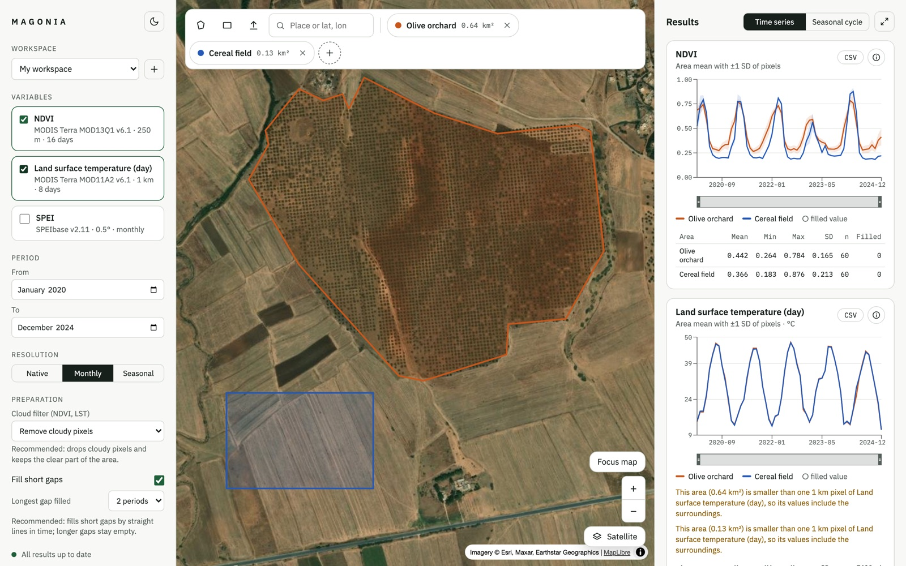
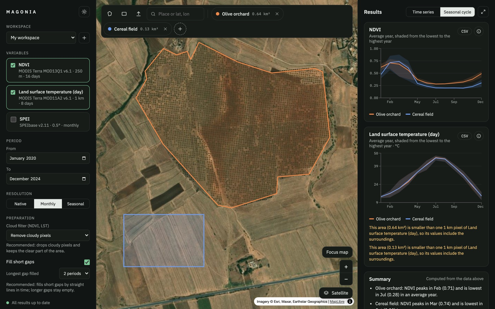

# Magonia

A research workbench for agricultural remote sensing. Researchers draw or upload
areas on a map, choose satellite and climate variables, and compare them over time,
without writing code. Every result shows where it came from.

Named after Mago of Carthage, whose 28-book treatise on agriculture Rome had translated
after the city fell, and after Magonia, the medieval kingdom in the sky.



## Version 1

- **Areas:** draw polygons or rectangles, upload GeoJSON, KML or zipped shapefiles,
  search places or coordinates; areas are checked, measured and saved per workspace.
- **Data:** MODIS NDVI (250 m, 16 days), MODIS land surface temperature (1 km, 8 days)
  and SPEI drought index (0.5°, monthly, 1 to 48 months), through Google Earth Engine.
- **Preparation:** cloud filtering by pixel or by date, monthly or seasonal means, gap
  filling with filled values marked; recommended steps are pre-selected with their reason.
- **Charts:** one line per area with the spatial spread of the pixels, seasonal cycles,
  descriptive statistics, CSV download and a summary computed from the numbers.
- **Provenance:** each series records its product, licence, area, window and every
  processing step, with a stable id that changes whenever anything changes.
- **Trust:** an acceptance test checks that Magonia reproduces an independent
  extraction of NDVI, LST and SPEI for a reference orchard, exactly.



## Running it

Requires Python 3.12+, [uv](https://docs.astral.sh/uv/) and Node 24 (`.nvmrc`).

```bash
# once: sign in to Earth Engine (free for research; see code.earthengine.google.com/register)
uv run --directory engine earthengine authenticate

# terminal 1: the API on http://127.0.0.1:8000 (endpoints documented at /docs)
cd api && uv sync && uv run uvicorn api.main:app --reload

# terminal 2: the interface on http://localhost:5173
cd web && npm install && npm run dev
```

The first time, Magonia asks for your Earth Engine project id and checks that it
answers. Workspaces, areas and results are kept in `~/.magonia/magonia.db`.

## Structure

| Folder | Contents |
|---|---|
| `engine/` | Python package: Earth Engine extraction, preparation, provenance |
| `api/` | FastAPI service: background jobs, result cache, workspaces and areas |
| `web/` | React interface: map, data picker, charts |
| `docs/requirements/` | Software requirements specification |
| `docs/decisions/` | Architecture decision records |
| `docs/DEVELOPMENT.md` | Workflow, tests and troubleshooting |

## Planning

Work is tracked on the GitHub project board in cycles. Each issue references a
requirement ID from the specification (for example `MAP-02`). Version 2 brings
sign-in and cloud deployment, decomposition and models with their explanations,
and the assistant.
