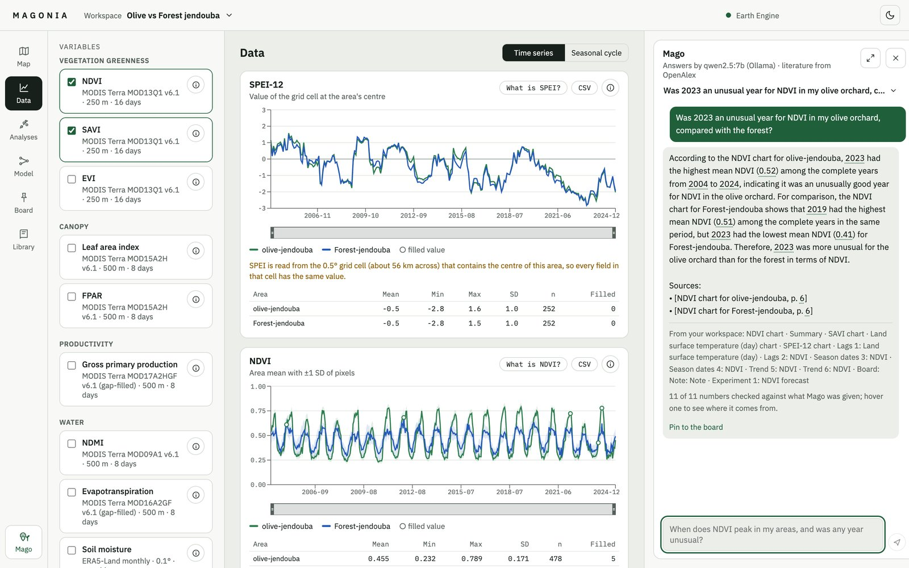
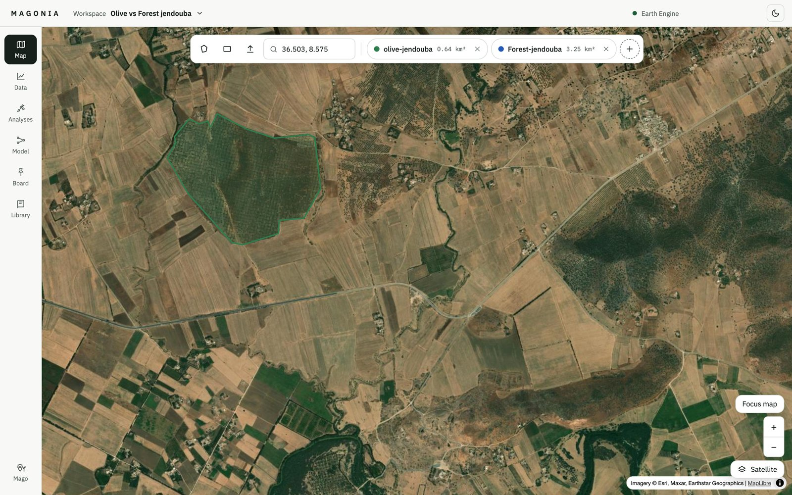
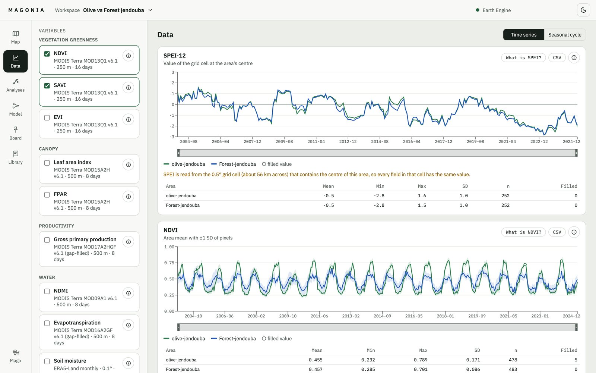
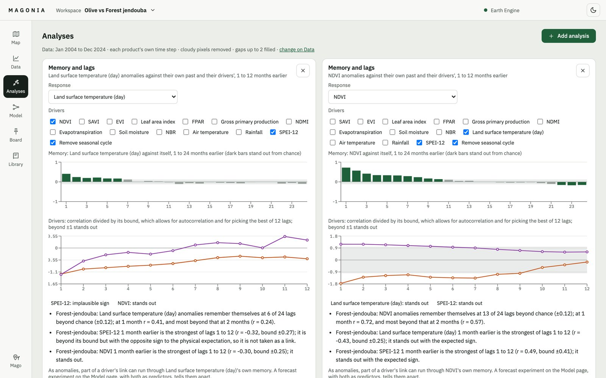
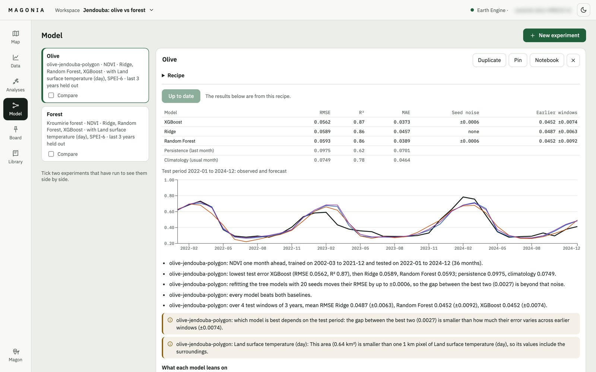
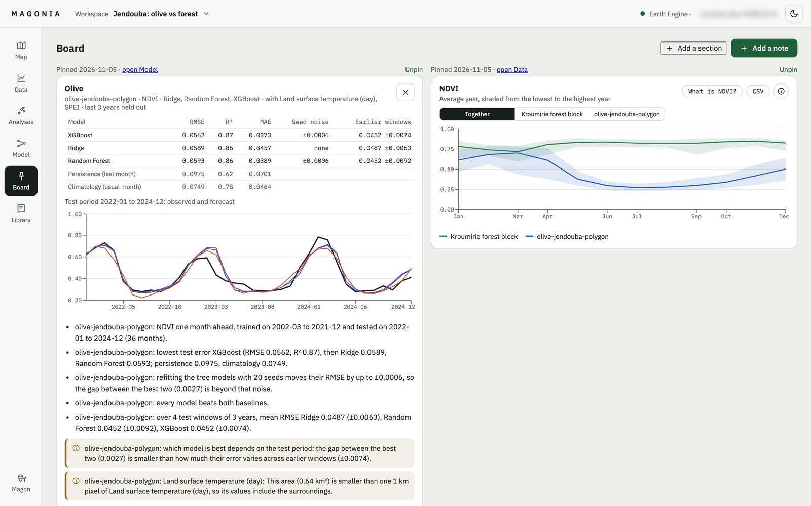
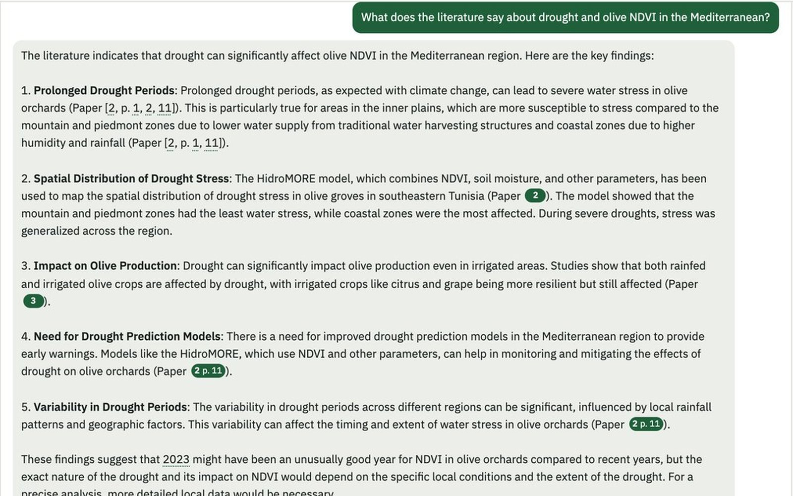

<div align="center">

# Magonia

**A research workbench for agricultural remote sensing, without code.**

Draw the fields you study, pick satellite and climate variables, and go from the data to
analyses, forecasts and the literature in one place. Every number shows where it came from.


</div>

## A Demo


https://github.com/user-attachments/assets/d3312055-112f-4f2b-b3aa-71946c39ff0b


Named after Magon of Carthage, whose 28-book treatise on agriculture Rome had translated
after the city fell. **Magon** is also the research assistant inside it.




## A tour

The pages follow the order of a research paper's method: from the field, to the data, to
what it means.

<table>
<tr>
<td width="50%"></td>
<td width="50%"></td>
</tr>
<tr>
<td><b>Map</b>: draw polygons or rectangles, or upload GeoJSON, KML or shapefiles. Each area is checked and measured.</td>
<td><b>Data</b>: 14 satellite and climate variables through Google Earth Engine, cleaned and gap-filled, with every step shown.</td>
</tr>
<tr>
<td></td>
<td></td>
</tr>
<tr>
<td><b>Analyses</b>: trend, season, phenology, correlation and lags. Each one exports as a notebook that reruns it.</td>
<td><b>Model</b>: forecasts with Ridge, Random Forest and XGBoost, scored against baselines and a noise floor.</td>
</tr>
<tr>
<td></td>
<td></td>
</tr>
<tr>
<td><b>Board</b>: pin charts and results, and write notes. The day's work on one page.</td>
<td><b>Magon</b>: answers from your data, your PDFs and the open literature, with every citation checked.</td>
</tr>
</table>

## Magon, the assistant

Magon runs on a small open model on your own network, so your data and papers stay with
you. It is not trusted blindly:

- **It answers from your workspace.** It reads the charts and analyses you have open, and
  the PDFs in your library.
- **It cites, and the citations are checked.** A citation to a paper that wasn't found is
  removed, a statement its paper doesn't support is flagged, and a page reference opens the
  paper at that page.
- **Its numbers are checked.** Every number in an answer is matched against what Magon was
  given.
- **It proposes, you act.** It can suggest an analysis, but nothing runs until you click.

Its quality is measured against the bare model it runs on, by the evaluation harness in
`engine/evaluation/`.

## What it covers

| | |
|---|---|
| **Variables** | NDVI, EVI, SAVI, NDMI, NBR, leaf area index, FPAR, gross primary production, evapotranspiration (MODIS); land surface temperature; air temperature, rainfall and soil moisture (ERA5-Land); the SPEI drought index |
| **Preparation** | Cloud filtering, monthly or seasonal means, gap filling with filled values marked, and a warning when a pixel is larger than the field |
| **Analyses** | Correlation and lag, trend and season, Mann–Kendall trend, season dates, memory and lags |
| **Forecasting** | Ridge, Random Forest and XGBoost, tuned on the training years only, compared with persistence and climatology, and with what each model relies on |
| **Library** | Your own PDFs, kept per workspace, plus standing instructions for Magon |
| **Safety net** | Deletions can be undone (⌘Z); deleted workspaces and conversations are kept for 30 days |

## Running it

Requires Python 3.12+, [uv](https://docs.astral.sh/uv/), Node 24 (`.nvmrc`) and, for Magon,
an [Ollama](https://ollama.com) server with `qwen2.5:7b` and `nomic-embed-text`.

```bash
cp .env.example .env    # then fill in your values; every variable is explained there

# once: sign in to Earth Engine (free for research; see code.earthengine.google.com/register)
uv run --directory engine earthengine authenticate

# terminal 1: the API on http://127.0.0.1:8000 (endpoints documented at /docs)
cd api && uv sync && uv run uvicorn api.main:app --reload

# terminal 2: the interface on http://localhost:5173
cd web && npm install && npm run dev
```

The first time, Magonia asks for your Earth Engine project id and checks that it answers.
Workspaces, areas, results and the library are kept in `~/.magonia/`. Without an Ollama
server everything works except Magon; `MAGONIA_MODEL_URL=scripted` gives fixed answers.

## Structure

| Folder | Contents |
|---|---|
| `engine/` | Python package, no web code: extraction, preparation, analyses, models, Magon's pipeline and its checks |
| `engine/evaluation/` | The evaluation harness: test cases, systems compared, scorer and report |
| `api/` | FastAPI service: workspaces, background jobs, the results cache, the library, Magon's streamed answers |
| `web/` | React interface: the pages above |
| `docs/requirements/` | Software requirements specification |
| `docs/decisions/` | Architecture decision records |
| `docs/DEVELOPMENT.md` | Workflow, tests, evaluation and troubleshooting |

## Next

Deep learning forecasting models alongside the current ones, sign-in and cloud deployment,
and Magon's evaluation on a second, independent set of questions.

## Contributing

Issues and pull requests are welcome. See [CONTRIBUTING.md](CONTRIBUTING.md).

## Licence

Magonia is free software under the [GNU Affero General Public License v3.0](LICENSE). You can
use, change and share it. If you run a changed version for others, including as a website,
you must offer them its source code.

Built by Ilyes Khayati, supervised by Dr. Oumayma Bounouh.
